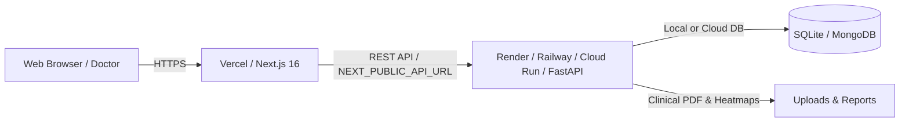

# Nuvica Cardiology & Vascular AI Platform - Deployment Guide

This project is a full-stack AI cardiovascular diagnostic suite composed of:
1. **Frontend**: Next.js 16 (React 19, Tailwind CSS v4, Lucide icons, Framer Motion, Recharts)
2. **Backend**: FastAPI (Python 3.11+, Pan-Tompkins ECG analysis, CXR segmentation, PDF report generation)

---

## Architecture Overview



---

## Option 1: Recommended Cloud Deployment (Free Tier Friendly)

The most popular, reliable, and zero-maintenance architecture is **Vercel** for the Next.js frontend and **Render** (or **Railway**) for the FastAPI backend.

### Step 1: Deploy Backend on Render

1. Sign up / Log in to [Render.com](https://render.com).
2. Click **New +** -> **Web Service**.
3. Connect your GitHub repository: `https://github.com/ramarnpavithranr/medical-project`.
4. Configure the service settings:
   - **Name**: `nuvica-cardiology-backend` (or your choice)
   - **Region**: Choose the closest region (e.g., Oregon, Frankfurt, Singapore)
   - **Root Directory**: `backend`
   - **Runtime**: `Python 3`
   - **Build Command**: `pip install -r requirements.txt`
   - **Start Command**: `uvicorn main:app --host 0.0.0.0 --port $PORT`
   - **Instance Type**: `Free`
5. Under **Environment Variables**, add:
   - `PORT`: `8000` (Render overrides this with dynamic port automatically)
   - `HOST`: `0.0.0.0`
   - `ALLOWED_ORIGINS`: `*` (or your Vercel URL once generated, e.g. `https://medical-project.vercel.app`)
   - *(Optional)* `MONGODB_URI`: (If using cloud MongoDB; defaults to local SQLite if omitted)
6. Click **Deploy Web Service**.
7. Once deployed, copy your backend URL (e.g. `https://nuvica-cardiology-backend.onrender.com`).
   - Verify it by visiting `https://<your-backend>.onrender.com/docs` to see interactive Swagger API docs.

---

### Step 2: Deploy Frontend on Vercel

1. Sign up / Log in to [Vercel.com](https://vercel.com).
2. Click **Add New...** -> **Project**.
3. Import your GitHub repository: `ramarnpavithranr/medical-project`.
4. Configure the project:
   - **Framework Preset**: `Next.js`
   - **Root Directory**: `./` (Default root)
   - **Build Command**: `npm run build` (Default)
   - **Output Directory**: `.next` (Default)
5. Expand **Environment Variables** and add:
   - **Key**: `NEXT_PUBLIC_API_URL`
   - **Value**: `https://<your-backend>.onrender.com` (from Step 1)
6. Click **Deploy**.
7. Vercel will build and deploy your app in ~1 minute. Click the provided live URL (e.g., `https://medical-project.vercel.app`).

---

### Step 3: Link CORS in Backend

Once your Vercel frontend URL is live:
1. Return to Render -> your backend service -> **Environment**.
2. Update `ALLOWED_ORIGINS` to include your Vercel URL:
   ```env
   ALLOWED_ORIGINS=https://medical-project.vercel.app,http://localhost:3000
   ```
3. Save changes (Render will automatically redeploy with CORS restricted to your official frontend domain).

---

## Option 2: Full-Stack Docker Deployment (Single Server / VPS / Cloud Run)

Both services can be run together using the provided `Dockerfile` and `docker-compose.yml`.

### Prerequisites
- Docker Engine & Docker Compose installed.

### Steps
1. Clone the repository on your server:
   ```bash
   git clone https://github.com/ramarnpavithranr/medical-project.git
   cd medical-project
   ```
2. Build and launch all containers:
   ```bash
   docker compose up -d --build
   ```
3. Check running services:
   ```bash
   docker compose ps
   ```
4. Access the platforms:
   - **Frontend**: `http://localhost:3000` (or your server's public IP)
   - **Backend API**: `http://localhost:8000`
   - **Swagger Docs**: `http://localhost:8000/docs`

---

## Option 3: Railway / Koyeb

### Deploying Backend on Railway:
1. Go to [Railway.app](https://railway.app) and create a New Project.
2. Select **Deploy from GitHub repo** -> `ramarnpavithranr/medical-project`.
3. In settings, set **Root Directory** to `/backend`.
4. Railway will automatically detect Python, install dependencies, and run with the included `Procfile`.
5. Under **Variables**, add:
   - `ALLOWED_ORIGINS`: `*`
6. Generate a public domain under **Networking**.

---

## Environment Variables Reference

| Variable | Scope | Description | Default |
|---|---|---|---|
| `NEXT_PUBLIC_API_URL` | Frontend | Base URL of the backend API service | `http://localhost:8000` |
| `PORT` | Backend | HTTP port FastAPI listens on | `8000` |
| `HOST` | Backend | Host bind address | `0.0.0.0` |
| `ALLOWED_ORIGINS` | Backend | Comma-separated allowed CORS origins | `*` |
| `MONGODB_URI` | Backend | Optional MongoDB connection URI | SQLite (`cardiology.db`) |
