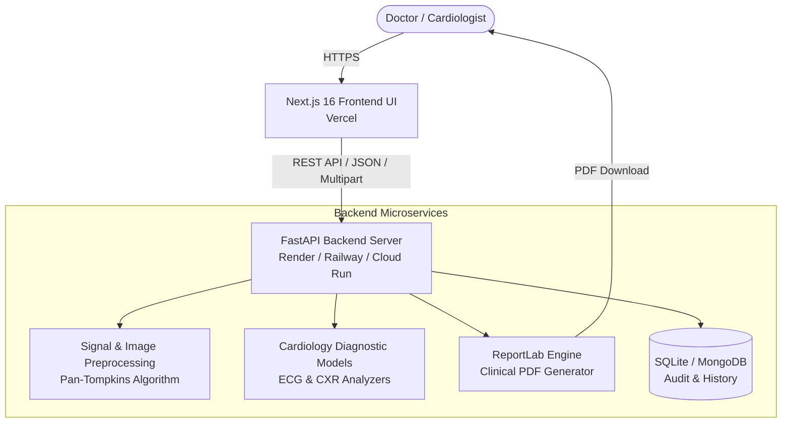

# 🫀 Nuvica Cardiology & Vascular AI Platform

[](https://nextjs.org/)
[](https://react.dev/)
[](https://fastapi.tiangolo.com/)
[](https://tailwindcss.com/)
[](https://www.docker.com/)
[](LICENSE)

An enterprise-grade, multimodal **Cardiovascular AI Diagnostic & Clinical Decision Support Suite**. Built with a high-performance **Next.js 16** frontend and a specialized **FastAPI** biomedical AI microservice supporting automated ECG waveform signal processing, Chest X-ray (CXR) segmentation, risk stratification, and automated clinical PDF report generation.

---

## 🌟 Key Highlights

- **⚡ Multimodal Diagnostic Engine**: Analyze both 12-lead ECG signals (`.csv`, `.dat`) and Chest X-Rays (`.png`, `.jpg`, `.dicom`) simultaneously.
- **📈 Advanced ECG Signal Processing**: Pan-Tompkins QRS complex detection, RR-interval variability analysis, and real-time arrhythmia classification (Normal Sinus, Tachycardia, Bradycardia, AFib).
- **🩻 Chest X-Ray AI Segmentation**: Cardiothoracic Ratio (CTR) computation, deep learning cardiomegaly detection, and Grad-CAM explainability heatmaps.
- **📄 Automated Clinical PDF Generation**: Instant generation of standardized, physician-ready diagnostic reports with ECG waveforms, cardiac metrics, and diagnostic interpretations.
- **🛡️ Enterprise Architecture**: Clean decoupled architecture ready for cloud deployment on Vercel (Frontend) and Render/Railway/Docker (Backend).

---

## 🏗️ System Architecture



---

## 🚀 Quick Start

### 1. Prerequisites
- **Node.js**: `v20.x` or later
- **Python**: `3.11` or later
- **Git**

---

### 2. Run with Docker Compose (Recommended)

Run the full stack (Frontend + Backend) with a single command:

```bash
docker compose up --build
```

- **Frontend Application**: [http://localhost:3000](http://localhost:3000)
- **Backend API & Swagger Docs**: [http://localhost:8000/docs](http://localhost:8000/docs)

---

### 3. Manual Local Setup

#### A. Backend (FastAPI)
```bash
# Navigate to backend directory
cd backend

# Create and activate a virtual environment
python -m venv venv
# Windows:
venv\Scripts\activate
# Linux/macOS:
source venv/bin/activate

# Install dependencies
pip install -r requirements.txt

# Start the development server
uvicorn main:app --reload --host 0.0.0.0 --port 8000
```
API Documentation will be live at `http://localhost:8000/docs`.

#### B. Frontend (Next.js)
```bash
# In the root project directory:
npm install

# (Optional) Configure environment variables
cp .env.example .env.local

# Start Next.js development server
npm run dev
```
Open [http://localhost:3000](http://localhost:3000) in your browser.

---

## ⚙️ Environment Variables

### Frontend (`.env.local`)
| Variable | Description | Default |
|---|---|---|
| `NEXT_PUBLIC_API_URL` | Base URL of the FastAPI backend microservice | `http://localhost:8000` |

### Backend (`backend/.env` or Cloud Provider)
| Variable | Description | Default |
|---|---|---|
| `PORT` | Port for the FastAPI server | `8000` |
| `HOST` | Host address to bind to | `0.0.0.0` |
| `ALLOWED_ORIGINS` | Comma-separated list of allowed CORS origins | `*` |
| `MONGODB_URI` | Optional MongoDB connection string (falls back to SQLite) | `cardiology.db` |

---

## 🌐 Deployment Guide

### Frontend on Vercel
1. Push your repository to GitHub.
2. In [Vercel](https://vercel.com), import your repository: `ramarnpavithranr/medical-project`.
3. In **Project Settings** > **Environment Variables**, add:
   - `NEXT_PUBLIC_API_URL` = `https://<your-backend-domain>`
4. Deploy!

> **Note on Vercel Preview Protection**: If your deployment link redirects to a Vercel login screen, go to **Project Settings** > **Deployment Protection** and set **Vercel Authentication** to **Disabled**, or click **Promote to Production** on your deployment.

### Backend on Render / Railway
1. Create a new **Web Service** pointing to your repository.
2. Set **Root Directory** to `backend`.
3. Set **Build Command**: `pip install -r requirements.txt`
4. Set **Start Command**: `uvicorn main:app --host 0.0.0.0 --port $PORT`
5. Set environment variable: `ALLOWED_ORIGINS=*` (or your Vercel URL).

For complete deployment details, see [`DEPLOYMENT.md`](./DEPLOYMENT.md).

---

## 📂 Project Structure

```
├── backend/                   # FastAPI Python backend
│   ├── main.py                # Server entrypoint and CORS setup
│   ├── requirements.txt       # Python dependencies
│   ├── database.py            # SQLite / MongoDB persistence layer
│   ├── lib_risk.py            # Cardiovascular risk calculators
│   ├── routers/               # API route definitions
│   │   └── cardiology.py      # Diagnostic endpoints & report downloads
│   ├── services/              # Medical business logic & signal processing
│   │   ├── model_service.py   # Arrhythmia & CXR segmentation models
│   │   ├── preprocessing.py   # Pan-Tompkins QRS detection algorithm
│   │   └── report_service.py  # ReportLab clinical PDF generator
│   ├── reports/               # Generated clinical PDF records
│   └── uploads/               # Temporary uploaded medical assets
├── public/                    # Static assets, 3D organ visuals & samples
│   ├── samples/               # Sample ECG CSVs & sample CXR images
│   └── images/                # Medical UI photography and graphics
├── src/
│   ├── app/                   # Next.js 16 App Router
│   │   ├── page.tsx           # Hospital & cardiology landing page
│   │   ├── layout.tsx         # Global layout & metadata
│   │   ├── cardiology/        # Diagnostic studio, results & history
│   │   └── get-started/       # Onboarding workflow
│   ├── components/            # Reusable UI & diagnostic components
│   │   ├── cardiology/        # Upload studio, waveform charts, heatmaps
│   │   └── common/            # Navbar, Footer, and shared elements
│   └── lib/                   # API clients and TypeScript interfaces
├── docker-compose.yml         # Full-stack container orchestration
├── Dockerfile                 # Multi-stage production container build
├── DEPLOYMENT.md              # Production deployment documentation
└── README.md                  # Project overview and documentation
```

---

## 🧪 Sample Medical Data for Testing

Pre-packaged medical sample files are provided in [`public/samples/`](./public/samples/):
- **Normal Sinus ECG**: `public/samples/normal_sinus_ecg.csv`
- **Tachycardia ECG**: `public/samples/tachycardia_ecg.csv`
- **Normal Chest X-Ray**: `public/samples/sample_normal_cxr.png`
- **Cardiomegaly Chest X-Ray**: `public/samples/sample_cardiomegaly_cxr.png`

---

## 📄 License

This project is licensed under the MIT License. See the [LICENSE](LICENSE) file for details.
